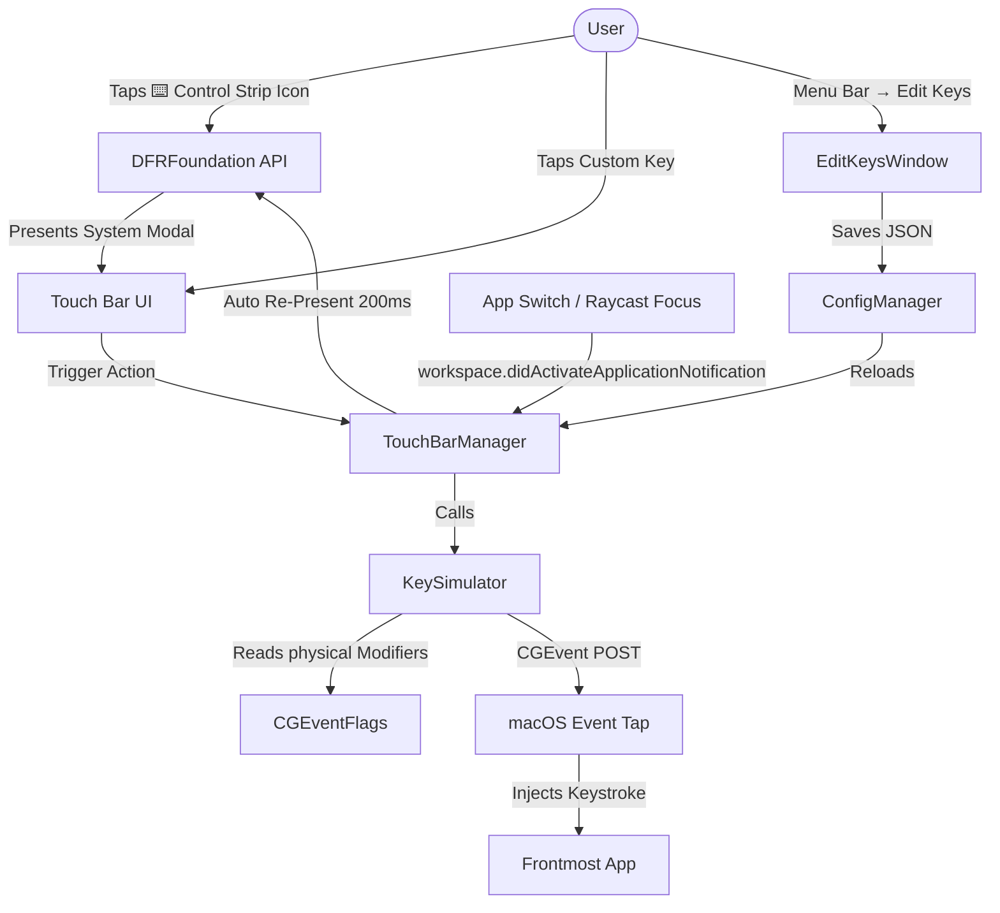

# 🎹 bttopn

<p align="center">
  <strong>A lightweight, 100% free, and open-source alternative to BetterTouchTool (BTT) for macOS.</strong><br />
  <em>Specifically engineered to customize your MacBook Touch Bar, map persistent custom keys, and seamlessly replace broken physical keys.</em>
</p>

<p align="center">
  
  
  
  
  
</p>

---

## 💡 Why bttopn?

If you use a MacBook with a Touch Bar and have physical keyboard keys that are broken or unresponsive, **BetterTouchTool (BTT)** is the standard recommendation for mapping replacement keys on your Touch Bar. However, BTT is paid proprietary software, often packed with complex features you might not need if you just want to regain typing functionality.

**bttopn** is built to solve this exact problem beautifully, natively, and with virtually **zero configuration or overhead**.

---

## ✨ Features

- 🎹 **Custom Overlay Keys:** Quickly add custom buttons to your Touch Bar that trigger any physical keyboard keystroke.
- 🚀 **Key Actions:** Every key can do more than type — simulate **media keys** (volume, brightness, play/pause), **launch apps**, **open URLs**, **run shell commands**, or **snap the active window** (halves, thirds, maximize, center).
- 🗂️ **Per-App Profiles:** Define different Touch Bar layouts for different apps (e.g. Raycast, Terminal, VS Code). bttopn swaps them automatically as you switch apps.
- 🔄 **Persistent Auto-Restore:** Automatically detects frontmost application switches. If you invoke **Raycast, Spotlight, Alfred**, or any launcher, **bttopn** keeps your custom keys active and visible without interruptions.
- ⌨️ **Physical Modifier State Sync:** Fully recognizes held physical modifier keys (`Cmd`, `Shift`, `Opt`, `Control`). Hold physical `Cmd` and tap your Touch Bar `Z` key to trigger `Cmd + Z`.
- ⌘ **One-Tap Shortcuts:** Any key can carry **static modifiers** (`⌘⇧⌥⌃`) — tap once to send `Cmd + Z` to undo, no need to hold anything. Unioned with whatever you're physically holding.
- 🎛️ **Seamless Control Strip Toggle:** A clean ⌨️ icon sits persistently in your Control Strip. Tap it to slide in your custom keys instantly; tap again to hide them and return to standard macOS actions.
- ⌨️ **Global Hotkey:** Press `⌃⌥⌘B` anywhere to show/hide your keys — no need to reach for the Control Strip icon.
- 🖱️ **Interactive GUI Editor:** Built-in native macOS window for managing, **reordering**, and adding new keys or profiles in seconds.
- 🔁 **Launch at Login:** Optional menu-bar toggle to start bttopn automatically when you log in.
- 📋 **Clipboard History:** Menu-bar list of your last 10 copied text snippets — click one to paste it into the frontmost app. **Off by default**, text-only, in-memory only, and concealed pasteboards (password managers) are never stored.
- 🚀 **Ultra-lightweight:** Compiled natively in Swift. Hides from the Dock/App Switcher, running quietly in the menu bar with `0%` idle CPU usage and < `15MB` RAM footprint.

---

## ⚡ bttopn vs. BetterTouchTool (BTT)

| Feature | **bttopn** (Open Source) | **BetterTouchTool** (BTT) |
| :--- | :--- | :--- |
| **Cost** | 🆓 **100% Free & Open Source** | 💰 Paid ($10 – $22+) |
| **Footprint** | ⚡ Extremely light (`<15MB` RAM, `0%` idle CPU) | 📦 Heavier / Feature Rich |
| **Source Code** | 🔓 Fully Open Source (MIT License) | 🔒 Proprietary / Closed Source |
| **Broken Key Mapping**| ✅ Instant, out-of-the-box | ✅ Supported |
| **Per-App Touch Bar Layouts**| ✅ **Per-app profiles, swapped automatically** | ✅ Supported |
| **Key Actions**| ✅ Keystrokes, media keys, launch apps, open URLs, shell commands, window snapping | ✅ Supported |
| **Window Snapping**| ✅ Halves, thirds, maximize, center — via Accessibility API | ✅ Supported |
| **Per-Key Static Modifiers**| ✅ One-tap `⌘Z`, `⌘⇧4`, … | ✅ Supported |
| **Clipboard Manager**| ✅ Text history, in-memory, off by default, concealed types excluded | ✅ Supported |
| **Works Without Touch Bar**| ✅ Clipboard history + window snapping via menu bar | ✅ Supported (paid) |
| **Global Hotkey Toggle**| ✅ `⌃⌥⌘B` | ✅ Customizable |
| **Launch at Login**| ✅ Menu-bar toggle | ✅ Supported |
| **Raycast/Spotlight Sync**| 🔄 **Auto-Restores Touch Bar instantly** | ⚠️ Requires manual settings tweak |
| **Control Strip Integration**| ⌨️ Persistent togglable icon | ✅ Supported |
| **Complex Gestures/Sliders**| ❌ Removed to stay fast & lightweight | ✅ Supported |

---

## 🚀 Quick Start & Installation

### 1. Download and Install
1. Head over to the [Releases](https://github.com/r69shabh/bttopn/releases) page and download the latest `bttopn-vX.Y.Z.zip`.
2. Extract the ZIP archive.
3. Drag `bttopn.app` directly into your `/Applications` folder.
4. Double-click to launch.

### 2. Grant Accessibility Permissions
Because **bttopn** simulates low-level hardware keystrokes using Apple's `CGEvent` APIs, macOS requires Accessibility authorization:
1. Upon first launch, you will see a macOS permission request.
2. Open **System Settings → Privacy & Security → Accessibility**.
3. Toggle the switch **ON** for **bttopn**.
*(Note: If you move the app's location on disk, macOS may quietly revoke permissions. Simply remove it from the list using the `-` button and re-add it).*

---

## 🛠️ Architecture & Under the Hood

Apple's public `NSTouchBar` framework is strictly **context-sensitive**—meaning it only displays controls relevant to the active, focused app. When you switch applications, your custom Touch Bar vanishes.

To bypass this and achieve system-wide persistence, **bttopn** hooks into Apple's private `DFRFoundation` framework:

1. **Persistent System Tray Entry:** Uses `NSTouchBarItem.addSystemTrayItem` and `DFRElementSetControlStripPresenceForIdentifier` to mount a dedicated `⌨️` trigger directly in the Control Strip.
2. **System Modal Overlay:** Employs `NSTouchBar.presentSystemModalTouchBar` to elevate the custom keys to a high-priority system-modal overlay, rendering it above whatever Touch Bar layout the active app demands.
3. **App-Switch Interceptor:** Subscribes to `NSWorkspace.didActivateApplicationNotification`. When a launcher like Raycast steals window focus and overrides the Touch Bar, **bttopn** waits `200ms` (for the OS transition to settle) and programmatically re-asserts the system modal overlay. The same path resolves the frontmost app's **per-app profile** and rebuilds the key set when it changes.
4. **Keystroke Simulation:** Listens to the hardware keyboard's modifier state via `CGEventSource.flagsState(.hidSystemState)` and broadcasts synthetic key-down/key-up sequence events to the frontmost window using `CGEvent.post(tap: .cghidEventTap)`.
5. **Key Actions:** Each button dispatches through `ActionRunner`: virtual keycodes via the CGEvent path above, media keys via the `systemDefined`/`NX_KEYTYPE_*` event path, window snapping via the Accessibility API (`WindowManager`), and app/URL/shell actions via `NSWorkspace` / `Process`.
6. **Global Hotkey:** A Carbon `RegisterEventHotKey` binding (`⌃⌥⌘B`) toggles the overlay from anywhere — no Accessibility prompt needed for the hotkey itself.

### System Flow Architecture



---

## ⚙️ Configuration

You can easily configure your keys through two different methods:

### Method A: Built-in GUI Editor (Recommended)
1. Click the `⌨️` icon in your macOS top **Menu Bar**.
2. Select **Edit Keys…** to open the interactive editor.
3. Use the **Applies to** dropdown at the top to edit the **Default** layout or a **per-app profile**. `+` adds a profile (pick any `.app`); `−` removes the selected profile.
4. For each key, pick an **Action** (`Key Press`, `Media Key`, `Launch App`, `Open URL`, `Shell Command`) and set its parameter.
5. Use the `↑`/`↓` buttons on each row to reorder keys.
6. Click **Save & Apply** — changes go live instantly.

### Clipboard History
1. Click the `⌨️` icon in your macOS top **Menu Bar** → **Clipboard History** → **Enabled**.
2. Copy text as usual. Open the same menu to see your last 10 snippets.
3. Click any item to paste it into the frontmost app (`⌘V` is injected for you).
4. **Clear History** wipes the list; quitting bttopn always clears it.

**Privacy guarantees:** text-only, stored in memory (never written to disk), off by default, and pasteboards marked `org.nspasteboard.ConcealedType` / `TransientType` / `AutoGeneratedType` (1Password, system auto-paste, etc.) are never recorded.

### Quick Global Shortcuts
- **`⌃⌥⌘B`** — show/hide your Touch Bar keys overlay

### Method B: Manual JSON File Editing
If you prefer configuring via code or want to backup your settings, the configuration is stored in a clean JSON format (schema v2):
📁 `~/.config/bttopn/keys.json`

```json
{
  "keys": [
    { "label": "9", "keyCode": 25 },
    { "label": "Vol+", "keyCode": 0, "action": "mediaKey", "value": "Volume Up" },
    { "label": "Calc", "keyCode": 0, "action": "launchApp", "value": "com.apple.Calculator" },
    { "label": "GitHub", "keyCode": 0, "action": "openURL", "value": "https://github.com" },
    { "label": "🧹",   "keyCode": 0, "action": "shell",    "value": "rm -rf ~/Downloads/tmp_*" },
    { "label": "Left ½", "keyCode": 0, "action": "windowSnap", "value": "Left Half" },
    { "label": "Undo", "keyCode": 6, "modifiers": ["cmd"] },
    { "label": "Screenshot", "keyCode": 21, "modifiers": ["cmd", "shift"] }
  ],
  "profiles": [
    {
      "bundleID": "com.raycast.macos",
      "name": "Raycast",
      "keys": [
        { "label": "↩", "keyCode": 36 },
        { "label": "⎋", "keyCode": 53 }
      ]
    }
  ]
}
```

**Schema v2 notes:**
- Entries without an `action` field decode as `"key"` — old v1 configs keep working unchanged.
- `profiles[i].keys` replaces the default layout **only while that app (by bundle ID) is frontmost**. Any other app gets the top-level `keys`.
- `mediaKey` values: `Volume Up`, `Volume Down`, `Mute`, `Brightness Up`, `Brightness Down`, `Play / Pause`, `Next Track`, `Previous Track`.
- `windowSnap` values: `Left Half`, `Right Half`, `Left Third`, `Right Third`, `Maximize`, `Center` — snaps the frontmost window via the Accessibility API.
- `launchApp` takes a bundle identifier (e.g. `com.apple.Calculator`). If the app is already running it is activated instead of relaunched.
- `shell` commands run via `/bin/sh -c` in the background.
- `modifiers` on any `key` action holds those modifiers while the key fires — valid values: `cmd`, `shift`, `option`, `control`. Unioned with physically held modifiers.
*(Tip: Refer to `Sources/KeyCodes.swift` for a comprehensive list of standard macOS virtual keycodes).*

---

## 🧱 Local Compilation (For Contributors)

You do not even need Xcode to compile and build this project locally. A lightweight shell script compiles the Swift source files directly using the system command-line compiler:

```bash
# Clone the repository
git clone https://github.com/r69shabh/bttopn.git
cd bttopn

# Build the app bundle
chmod +x build.sh
./build.sh
```

**Prerequisites:** Requires macOS SDK and Swift Command Line Tools (available via `xcode-select --install`).

**Run the headless config tests** (no Touch Bar or Accessibility needed):

```bash
./test.sh
```

**Persistent Accessibility permission (stable local signing):** an ad-hoc signed build is seen as a *new app* by macOS on every reinstall, so the Accessibility grant must be re-added each time. Fix — sign every build with one stable self-signed certificate:

```bash
openssl req -x509 -newkey rsa:2048 -keyout bttopn-sign.key -out bttopn-sign.crt -days 3650 -nodes \
  -subj "/CN=bttopn Local Signing" \
  -addext "keyUsage=critical,digitalSignature" \
  -addext "extendedKeyUsage=codeSigning"
openssl pkcs12 -export -out bttopn-sign.p12 -inkey bttopn-sign.key -in bttopn-sign.crt \
  -passout pass:bttopn-local -macalg SHA1 -keypbe PBE-SHA1-3DES -certpbe PBE-SHA1-3DES
security import bttopn-sign.p12 -k ~/Library/Keychains/login.keychain-db -P bttopn-local -T /usr/bin/codesign
rm bttopn-sign.key bttopn-sign.crt bttopn-sign.p12   # private key stays in your login keychain
```

`./build.sh` automatically signs with `bttopn Local Signing` when present (check with `codesign -d -r- build/bttopn.app` — the designated requirement will say `certificate leaf = …`, which is stable across builds). One re-grant of Accessibility is needed after switching to a stable signature; after that it **persists across every reinstall**.

---

### Touch Bar recovery (the "dies after N Raycast invocations" fix)
macOS can stop accepting bttopn's system-modal Touch Bar when the client hammers `presentSystemModalTouchBar` — historically observed as "keys work for a while, then vanish; only re-registering (e.g. toggling Raycast's hotkey) revives them". bttopn now defends itself:

1. **Never re-presents while the bar is visible** — zero redundant Control Strip re-layouts on app switches.
2. **Attempt-based exponential backoff** (2s → 8s cap) — the old watchdog presented ~2× per second, which is exactly the abuse that gets Touch Bar clients throttled.
3. **Circuit breaker** — after 8 consecutive rejected presents, bttopn stops all present calls instead of deepening the ban. The keys stay hidden until you press **⌃⌥⌘B** (fresh attempt) or bttopn's one-shot auto-restart re-registers with the Touch Bar server (rate-limited to once per hour).
4. **Secure Input** (password fields, Wi-Fi prompts): the overlay pauses while it's held and returns the moment it releases. Synthetic keystrokes can't type into Secure Input fields on any app — that's an OS rule, not ours (BTT is bound by it too). bttopn tells you instead of failing silently (a beep on tap).
5. **Persisted wanted-state** (`touchBarKeysWanted`) — restarting bttopn (auto or manual) always restores your keys exactly as you left them.

*(If you explicitly choose **Quit bttopn**, your keys stay off on the next launch — by design.)*

## ⚠️ Important Limitations

As **bttopn** relies on private Apple system frameworks (`DFRFoundation`):
- **Mac App Store:** It cannot be submitted to the official Mac App Store due to private API usage.
- **macOS Updates:** Apple may occasionally modify or deprecate undocumented system methods. While this mechanism has remained stable from macOS Mojave (10.14) up to macOS Sonoma/Sequoia (14/15), future OS iterations might require updates.
- **Scope Limit:** Unlike BTT, there is no support for complex multi-touch gestures, trackpad remapping, window snapping, or sliders. It remains strictly focused on lightning-fast Touch Bar key simulation.

---

## 📄 License & Contributing

- Distributed under the **MIT License**. See `LICENSE` for details.
- **Contributions are highly welcome!** Feel free to open issues for bug reports, suggest improvements, or submit pull requests.
